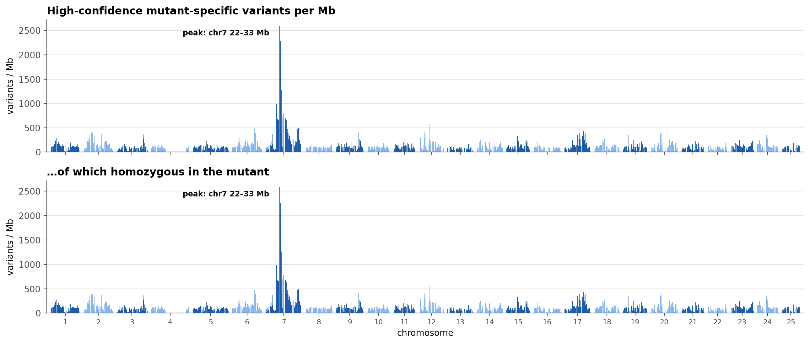
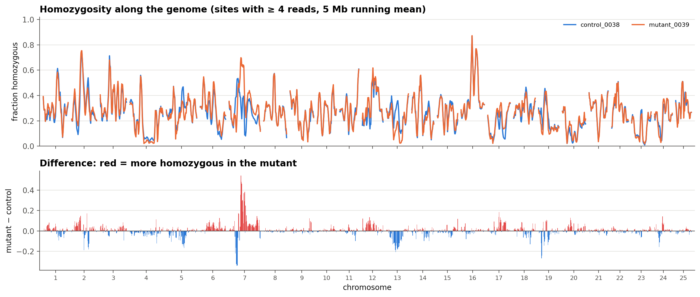
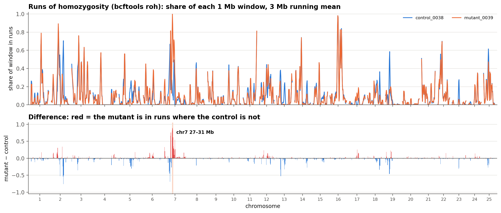
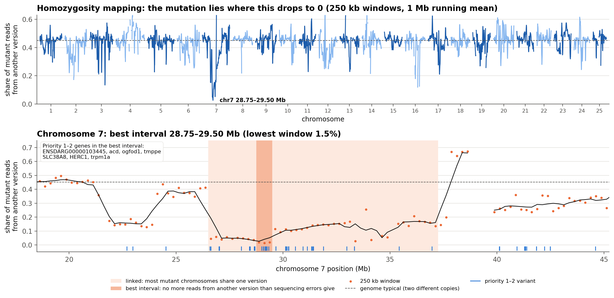
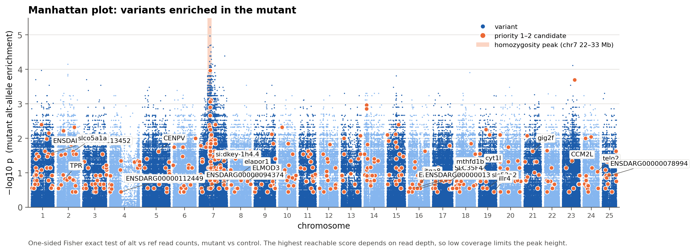

# Example: the dataset used to build this pipeline
{: .no_toc }

1. TOC
{:toc}

---

## The data

| Sample | Group | File | Reads |
|---|---|---|---|
| `control_0038` | control (sibling) | `L5756-0013-0038_S33_L005_R2_001.fastq.gz` | 61.3 M × 151 bp, single-end |
| `mutant_0039` | mutant | `L5756-0013-0039_S34_L005_R1_001.fastq.gz` | 73.5 M × 151 bp, single-end |

Only one read file per sample was available (R2 for the control and R1 for the
mutant), so the data was analysed as **single-end**.

The sample sheet used:

```
sample	group	fastq_1	fastq_2
control_0038	control	data/raw/L5756-0013-0038_S33_L005_R2_001.fastq.gz	
mutant_0039	mutant	data/raw/L5756-0013-0039_S34_L005_R1_001.fastq.gz	
```

## Data quality

| | control_0038 | mutant_0039 | Verdict |
|---|---|---|---|
| Reads kept after cleaning | 98.8% | 99.1% | ✓ Good |
| High-quality bases (Q30) | 97.7% | 97.3% | ✓ Good |
| Mapped to GRCz11 | 98.4% | 98.4% | ✓ Good |
| Duplicates | 13.2% | 12.8% | ✓ Good |
| **Mean usable coverage** | **2.8×** | **3.4×** | ✕ Low |
| Genome covered by ≥ 1 read | 78.6% | 81.0% | ✕ Low |

The sequencing itself is excellent; there just isn't much of it. About 89% of reads
contained adapter sequence, meaning the DNA fragments were short, often under
150 bp, so about a quarter of all sequenced letters were trimmed off. Together
with duplicates and reads that map ambiguously in repeats, that leaves about 3×
usable coverage. 15× or more is ideal.

## Variants

14.1 million variants passed the quality filter. That's normal for zebrafish: lab
strains are far more genetically diverse than mice or humans.

Sample 0038 comes from wild-type-looking **siblings** of the mutant, so the run uses
`mode: sibling` ([why](settings.html#choose-a-comparison-mode)). A candidate must be
carried in at least 90% of the mutant's reads. The sibling may carry it in up to 60%
of its reads, because it may carry one copy. (Whether each sample was one fish or a
pool of fish was not recorded; the thresholds suit both.)

| Category | Variants | HIGH impact | MODERATE impact |
|---|---:|---:|---:|
| Mutant-specific (high confidence) | 18,988 | 3 | 132 |
| Mutant-enriched (high confidence) | 154,760 | 29 | 1,028 |
| Mutant-specific (low confidence) | 2,111,050 | 379 | 10,348 |
| Mutant, not homozygous | 1,095,204 | 284 | 5,706 |
| Shared with the sibling | 5,341,182 | 1,260 | 40,493 |
| Control only | 5,104,933 | 1,175 | 22,216 |
| Low evidence | 319,791 | 104 | 765 |

The low-confidence group is large because at about 3× the sibling often has fewer
than 4 reads at a position, too few to judge.

### Checks on the candidates

Of the 1,192 high-confidence protein-changing variants:

* **623 are known** zebrafish variants (Ensembl/dbSNP): ordinary strain differences.
* **69** change the amino acid to the one already found in a published zebrafish
  protein (RefSeq). The reference genome carries a rare allele or an error there.
* **62** change it to the residue most other vertebrates have.
* **38** hit an amino acid that is identical in every species compared. These are the
  most likely to be damaging.

Known and flagged variants are moved to priority 5. Several of them looked like
excellent jaw candidates:

| Variant | Reads: mutant · sibling | Why it is priority 5 |
|---|---|---|
| *aldh1a2* P393A | 3/3 · 2/5 | Known (rs40833506); the zebrafish RefSeq protein NP_571925 has A, like the mutant |
| *slc39a13* A23P | 4/4 · 0/4 | Known polymorphism (rs507894324), despite a small jaw in the mouse knockout |
| *lgr4* I745V | 7/7 · 0/0 | V is the residue in human, rat, chicken, frog, medaka and fugu |
| *mmp14a* N338D | 3/3 · 1/1 | Known (rs179907423); the zebrafish RefSeq protein has D |
| *b3gat3* S94A | 9/9 · 3/3 | Known (rs180151941); the sibling looks homozygous too |

### Top candidates

| Priority | Variants | Examples |
|---|---:|---|
| 1 (HIGH, high confidence, homozygous) | 21 | stop gained in *SLC35F4*, *slc52a2*, *gig2f*; splice site in *itga8*, *TPR*, *cyt1l*; frameshift in *CENPV*, *CCM2L*; stop lost in *si:dkey-1h4.4* (chr7) |
| 2 (MODERATE, high confidence, homozygous) | 503 | 489 missense, 14 in-frame insertions or deletions |
| 3 | 3 | |
| 4 (low confidence) | 3,268 | |
| 5 (flagged) | 8,124 | known variants and flagged amino-acid changes |

Each priority-1 variant rests on only 3–8 reads in the mutant. Most also show the
variant in some sibling reads, as expected for a carrier, but at this depth that
can't be told apart from chance. They're **leads to test by PCR and Sanger
sequencing**, not conclusions. Only one of the 21 lies in the chr7 peak below.

A useful filter in the Excel file is priority 1–2, `novel` = TRUE and
`allele_check` = `conserved`. That leaves 22 variants genome-wide, and only two of
them inside the chr7 peak: *tmppe* R370W and *TJP1* P1240L.

### The mapping signal: chromosome 7

Five plots look at the same signal in different ways. The first four summarise
windows along the genome; only the last, the Manhattan plot, shows a p value.
Homozygosity mapping (plot 4) gives the narrowest answer: **chr7 28.75–29.5 Mb**.

**1. Variant density** (y axis: variants per Mb). How many high-confidence candidate
variants fall in each 1 Mb window: all of them on top, only those homozygous in the
mutant below.



The clearest result isn't any single variant but a **region**. Chromosome 7,
**22–33 Mb**, reaches up to 2,582 homozygous candidate variants per Mb, about 20
times the genome average of 125. It holds 14,867 of them. The region shows no
change in copy number.

**2. Homozygosity** (y axis: share of sites that are homozygous). Each sample's
share of homozygous sites per window, and below it mutant minus sibling.



**3. Runs of homozygosity** (y axis: share of each 1 Mb window inside a run).
`bcftools roh` walks along each chromosome and decides, site by site, whether both
copies are identical. Both samples share many short runs from the lab strain's
background (top). The difference (bottom) has one clear block: **chromosome 7,
27–31 Mb**, where the mutant is in runs over 92% of the region and the sibling over
12%. No other window in the genome reaches half that difference.



This narrows the 22–33 Mb density peak to its cleanest core. *tmppe* (29.2 Mb),
*HERC1* (29.2 Mb) and *si:dkey-1h4.4* (30.9 Mb) lie inside it; *TJP1* (31.1 Mb) is
just past its edge, where the mutant is in runs over 44% of the window.

**4. Homozygosity mapping** (y axis: share of mutant reads from another version of
the chromosome). The pipeline takes every site where the mutant carries a variant
and the sibling shows the reference letter, and asks how many mutant reads still
show the reference. Those reads come from a second, different version of the
chromosome. Next to a recessive mutation every mutant chromosome carries the same
version, so the share falls to about 0 (sequencing errors give 1–2%). Where the
mutant has two different copies it is about 45%, the genome-wide typical value.



The lowest point in the genome is **chr7 28.75–29.5 Mb**, at 1.5–1.9% (the next-best
chromosome, 16, only gets down to 12%). Along chromosome 7 the curve has steps:

| chr7 (Mb) | Share from another version | What it means |
|---|---|---|
| 21.75–24.0 | 13–19% | Mostly one version, but not all of the mutant DNA |
| **24.0–26.45** | **35–44%** | The mutant has two different copies. The mutation can't be here |
| 26.5–28.75 | 4–6% | Almost all one version |
| **28.75–29.5** | **1.5–1.9%** | **Only one version: the best interval** |
| 29.5–37.5 | mostly 9–21% | Mostly one version, but not all (33.5–34.5 Mb has too few informative sites to read) |

The 24.0–26.45 Mb block has sharp edges, normal read depth and allele fractions
centred on 50%, and the genes keep the same order in the newer assemblies GRCz12tu
and GRCz13ab, so it isn't a mapping or assembly artefact. The mutant really carries
two different versions there, most likely because the line's mutant chromosomes
picked up different pieces by crossing over in earlier generations.

The in-between values (4–19%) say something about the sample. One diploid fish
gives 0% or about 50% at each site, never 10%. Here the reads of the second version
are a minority at each site (mostly 1 in 6–8 reads), and they appear only at sites
where the sibling also carries that version, so they aren't errors. That fits a
mutant sample made of **several fish**, a few of which carry a crossover close to the
mutation. If so, the mutation must sit where **no** mutant fish carries another
version, which is 28.75–29.5 Mb.

Nine priority-2 variants lie in the best interval, in *tmppe* (R370W), *HERC1*
(Q3550H, D1201E), *SLC38A8*, *acd*, *ogfod1*, *trpm1a* and *ENSDARG00000103445*.
The report's peak table marks every variant as *best interval*, *linked* or
*outside*.

**5. Manhattan plot** (y axis: −log10 p). One dot per variant; its height is a
p value from **Fisher's exact test** on that variant's reads.

How one dot is calculated, using *tmppe* (chr7:29,157,506 C>T):

1. **Count the reads.** The mutant has 5 reads, all T; the sibling has 6, all C.
   Together: 11 reads, 5 of them T.
2. **Assume nothing is going on.** If T had nothing to do with which sample a read
   came from, the 5 T reads would be scattered at random over the 11 reads, like
   dealing 11 cards (5 marked) into a hand of 5 for the mutant and 6 for the sibling.
3. **Count every possible deal.** There are 462. Most give the mutant 2 or 3 T reads;
   only 1 gives it all 5.
4. **p is the share of deals at least as extreme as what we saw:** 1 in 462, so
   p = 0.0022. It is *one-sided*: only deals where the mutant has more T reads count.
5. **Plot −log10 p:** −log10 0.0022 = **2.66**, the height of the dot. A height of 2
   means p = 0.01, 3 means p = 0.001.

Three things follow:

- **Depth sets a ceiling.** Even the perfect pattern (every mutant read new, every
  sibling read reference) scores only 1.3 with 3 reads each, 2.4 with 5 each, and
  5.3 with 10 each. At our ~3× coverage the highest dot in the genome is 5.2.
- **Dots sit in horizontal bands**, because read counts are small whole numbers and
  only a few p values are possible.
- **The chr7 tower is a matter of numbers, not height.** Dots of 2 or more are 81
  times more frequent per Mb inside the peak (487 per Mb) than elsewhere (6 per Mb).
  It is the same linked region the density plot counts, seen one variant at a time.

There are 13 million tests and the p values are not corrected; a Bonferroni cut-off
would need 8.4, which no variant reaches. So read the plot for the **tower**, not for
any single dot. Slides [36–38]({{ '/slides/#36' | relative_url }}) work through the
calculation.



That's the expected footprint of a **recessive mutation**: the mutant carries two
identical copies of the chromosome segment around it, while the sibling doesn't.
The region holds 44 priority 1–2 variants, all novel. Most are passengers carried
along with the causal change. The leads worth testing first:

| Variant (chr7) | Position | Reads: mutant · sibling | Mapping | Notes |
|---|---|---|---|---|
| *tmppe* R370W | 29,157,506 | 5/5 · 0/6 | best interval | Novel; R in human, rat and chicken (conserved) |
| *HERC1* Q3550H | 29,211,339 | 7/7 · 0/5 | best interval | Novel, best read support; not conserved (other vertebrates have E) |
| *TJP1* P1240L | 31,126,090 | 3/3 · 2/8 | linked (12%) | Novel; P in human, rat, chicken and frog (conserved); the sibling looks like a carrier |
| *si:dkey-1h4.4* stop lost | 30,929,805 | 4/4 · 1/4 | linked (11%) | The only priority-1 variant in the peak; unnamed gene |

If the mutant sample is a pool, *tmppe* and *HERC1* are the stronger leads: at the
*TJP1* and *si:dkey-1h4.4* positions about one mutant read in nine comes from another
version of the chromosome.

The known jaw genes *cog4* and *thap11* (29.02 and 29.04 Mb) sit inside the best
interval with no coding change; *thap11* has a novel 5′ UTR variant. The full write-up is in
`analysis/jaw_candidates/STATUS.md`.

{: .note }
Genotyping a few chr7 variants (for example *HERC1* Q3550H, plus markers near 22 and
33 Mb) in about 20 mutants and 20 siblings will quickly show whether the region is
linked to the phenotype, and narrow it down.

### Structural variants

228 mutant-specific structural variants passed the filters: 214 deletions, 8
duplications, 4 insertions and 2 inversions. 148 of them overlap a gene. With
single-end reads only split reads can be used, so many larger events will be
missed.

## What this example teaches

{: .warning }
With **one sample per group at about 3× coverage**, many "mutant-specific" variants
are ordinary differences between the fish sampled, plus variants missed in the
thinly covered control. The pipeline flags all of this in the report.

To get a much cleaner answer from the next experiment:

1. **Sequence both reads (R1 + R2)** of each sample. That alone roughly doubles
   coverage and makes structural-variant calls far more sensitive.
2. **Aim for ≥ 15× per sample**, about 25 Gb of sequence for zebrafish.
3. **Use related controls**, as here: wild-type siblings from the same cross,
   ideally several, or a pool.
4. For a recessive mutation from a screen, **pool 20–50 mutants and 20–50 siblings**.
   The causal mutation is then the variant that is homozygous in the mutant pool
   and rarely homozygous in the sibling pool. Run such pools with `mode: sibling`
   ([settings](settings.html#choose-a-comparison-mode)).
